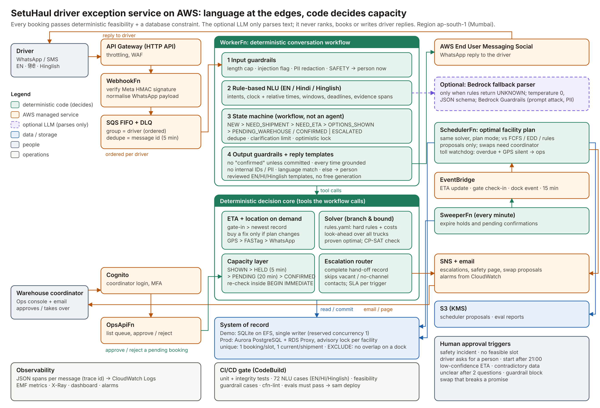

# SetuHaul Logistics — driver exception service (FDE Academy challenge)

**Live site:** https://sdaistudio.github.io/SetuHaul_Logistics/ — solution design, discussion prototype, data analysis, ER diagram & data browser, and every hand-in document.

| Page | Link |
|---|---|
| Home | https://sdaistudio.github.io/SetuHaul_Logistics/ |
| Solution design | https://sdaistudio.github.io/SetuHaul_Logistics/design.html |
| Discussion prototype | https://sdaistudio.github.io/SetuHaul_Logistics/prototype.html |
| L1 / L2 system design | https://sdaistudio.github.io/SetuHaul_Logistics/system-design.html |
| Situation walkthrough (data fetched per case) | https://sdaistudio.github.io/SetuHaul_Logistics/walkthrough.html |
| Demo 2 · coordinator control tower (GPS, RAG, WhatsApp, conversation dashboard) | https://sdaistudio.github.io/SetuHaul_Logistics/demo2.html |
| Data analysis | https://sdaistudio.github.io/SetuHaul_Logistics/analysis.html |
| ER diagram & data browser | https://sdaistudio.github.io/SetuHaul_Logistics/er.html |
| Decision register | https://sdaistudio.github.io/SetuHaul_Logistics/decisions.html |
| Solver design | https://sdaistudio.github.io/SetuHaul_Logistics/solver.html |
| Client readout | https://sdaistudio.github.io/SetuHaul_Logistics/readout.html |

Drivers message SetuHaul when they run late. This service answers them in English, Hindi or Hinglish, offers dock slots that are actually feasible, books them without ever double-booking, and hands a complete case to a person when no safe automatic answer exists.

**Design stance:** a deterministic *workflow*, not an autonomous agent. **No model ever chooses a slot**: a branch-and-bound solver searches every possible assignment of trucks to docks, scores each with the costs in `rules/rules.yaml`, and returns the proven optimum (cross-checked with OR-Tools CP-SAT). See `docs/03_solver_design.md`. Language understanding is rule-based and testable; feasibility, capacity and priority are code; a database constraint is the last line of defence. An LLM is optional and only parses text the rules could not.



## Hand-ins map

| # | Hand-in | Where |
|---|---|---|
| 1 | Problem Definition Sheet + data audit | `docs/01_problem_definition.md`, `audit/data_audit.sql`, `audit/findings.md` |
| 2 | Decision register (D1–D13) | `docs/02_decision_register.md` |
| 3 | Working prototype | `setuhaul/` (+ `setuhaul/cli.py` to chat), `infra/` for AWS |
| 4 | Scenario run | `scenarios/run_scenarios.py` → `scenarios/transcript.md` |
| 5 | Integrity proof | `tests/test_integrity.py` (10 drivers, 1 slot → 1 winner; storm test) |
| 6 | Client readout | `docs/06_client_readout.md` |
| + | Scheduling tool | `setuhaul/scheduler.py`, results in `scenarios/scheduler_runs.json` |

## Repository structure

```
setuhaul/
  config.py        policy constants (every number is a decision, see D-register)
  nlu.py           deterministic EN / Hindi / Hinglish parser with evidence spans
  eta.py           ETA resolution + confidence -> planning ETA
  feasibility.py   rules R1-R8, facility state, ranking
  capacity.py      SHOWN -> HELD -> PENDING -> CONFIRMED, atomic commit, sweeper
  workflow.py      conversation state machine (the "agent")
  guardrails.py    input / action / output guards
  templates.py     reviewed reply catalogue (EN / HI / Hinglish)
  escalation.py    triggers, routing, hand-off record
  solver.py        branch-and-bound optimiser + driver look-ahead (the heart)
  cpsat_check.py   independent optimality check with OR-Tools CP-SAT (optional)
  rules.py         loads rules/rules.yaml: every business number and hard rule
  location.py      value-of-information location pings + FASTag toll watchdog
  scheduler.py     facility plan: dispatch rules vs the optimal solver
  obs.py           traces, spans, CloudWatch EMF metrics
  llm_fallback.py  optional Bedrock parser (schema-validated, guardrailed)
  cli.py           chat with the agent in a terminal
rules/rules.yaml   all variables: timings, priorities, compatibility rules, costs, solver, location budget
tests/             integrity proof, workflow safety, solver optimality/determinism/closures
evals/             golden sets (52 tuned + 20 held-out NLU, 11 feasibility, 15 guardrail) + gate
scenarios/         scripted Jaipur replay -> transcript, measures, telemetry sample
audit/             20 data findings, each with its query
infra/             SAM template, Lambda handlers, Postgres schema, CodeBuild spec
docs/              solution design, problem sheet, decision register, solver design, client readout, architecture
analysis/          statistical analysis + ER diagram / data browser generators
tools/             build_site.py: the website published to GitHub Pages
site/              generated website (also published on the gh-pages branch)
data/              the supplied snapshot (never modified; work happens on copies); data/source: SQL seed, dictionary, guide, ER
```

## Code layers (L2 design)

| File | Layer | Handles |
|---|---|---|
| `setuhaul/model.py` | Language | Screen input, understand EN/HI/Hinglish into structured facts (rule parser; validated LLM fallback only on UNKNOWN), list missing facts, phrase reviewed templates, guard every reply. No database access, never decides a slot. |
| `setuhaul/tool.py` | Decisions | Tool contracts (`SPECS`) with READ/WRITE, caller and allowed states; feasibility, look-ahead ranking, hold / confirm / release, ETA record, escalation, coordinator approval, facility re-plan. `call()` validates every call; `capture()` records which tools ran. |
| `setuhaul/database.py` | Data | Named parameterised queries (`Q`), write helpers inside `BEGIN IMMEDIATE`, integrity by unique indexes / idempotency keys / dedupe, `capture_sql()` for tables read and written. |
| `setuhaul/scheduling_tool.py` | Facility scheduling tool | Explicit objective; FCFS / EDD / weighted / commitment-first vs optimal; protected work; proposes moves for approval, never writes. `python -m setuhaul.scheduling_tool --at 09:50 --eta SHP1009=12:20` |

`python tools/situation_walkthrough.py` runs every ladder level through the workflow and records the model step, tool calls and tables touched; `python tools/build_design_doc.py` regenerates the L1/L2 design from the code and that run.

## Run it (Python 3.10+, PyYAML; OR-Tools optional for the CP-SAT cross-check)

```bash
python -m unittest discover -s tests -v      # integrity proof
python -m audit.run_audit                    # data audit -> audit/findings.md
python -m scenarios.run_scenarios            # scenario run -> scenarios/transcript.md
python -m evals.run_evals                    # evals + gates -> evals/report.md (exit 1 on failure)
python -m setuhaul.cli --driver DRV014 --at 09:44   # chat as a driver (/plan, /board, /time 10:00)
python analysis/analyze.py && python analysis/build_report.py   # statistical profile (needs pandas, scipy)
python analysis/build_er.py                  # ER diagram + data browser
python tools/build_site.py                   # whole website -> site/ (needs markdown)
```

## Deploy to AWS (demo profile)

```bash
cd infra && sam build -t template.yaml && sam deploy --guided --region ap-south-1
```
Parameters: VPC + two private subnets (EFS), coordinator email, optional WhatsApp phone-number id (blank = replies logged), `EnableLLMFallback=1` to turn on the Bedrock parser and its guardrail. `SimulatedNow` replays 4 Aug 2026; blank it for live use. Production profile: swap EFS/SQLite for Aurora PostgreSQL using `infra/postgres_schema.sql` (adds the EXCLUDE overlap constraint) and lift WorkerFn's reserved concurrency. Template passes `cfn-lint`; it has not been deployed from this workspace.

## Results (deterministic, re-run any time)

| Gate | Result |
|---|---|
| NLU tuned set (52, EN/HI/Hinglish) | 100% |
| NLU held-out set (20, never tuned) | 80% |
| Feasibility golden cases | 11/11 |
| Guardrail cases | 15/15 |
| Integrity + safety + solver tests | 21/21 |
| Solver vs CP-SAT (same cost) | 8/8 instances |
| Double bookings in scenario run | 0 |
