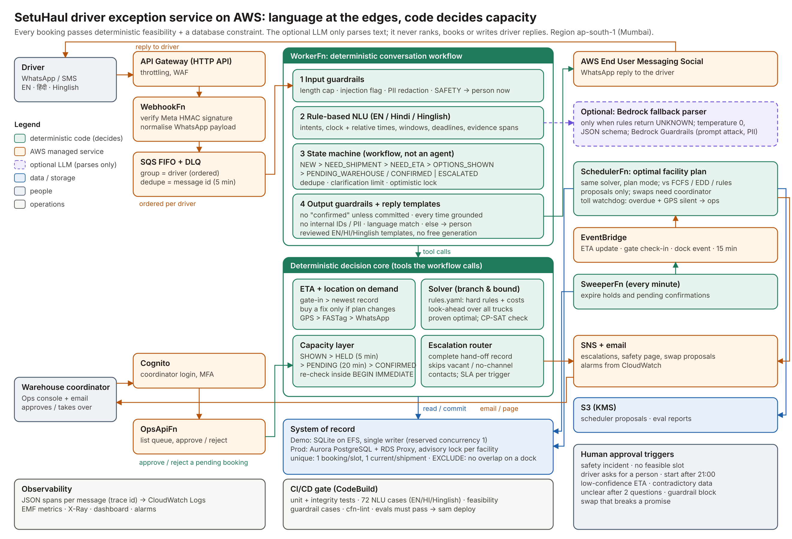

# SetuHaul — Solution Design for Discussion

FDE Academy challenge: driver exception service · 12 Nov 2026 (updated 17 Nov 2026)

> **Update after the 18 November review (v2).** A colleague reviewed this design (Doc A) against a second design and reconciled the two. The hand-ins of record are now in [`v2/` (the v2 hand-ins)](index.html#v2) (seven Word documents and a working prototype). This page stays as the add-on and scale path, updated to agree with the review:
> - **Pick = book.** A driver's or coordinator's pick books the slot in one checked transaction. There is no "Reply YES" round trip; a hold exists only while a warehouse coordinator decides.
> - **Approval deadline.** A booking waiting for approval lapses at min(booked + 15 min, slot start − 30 min), not after a fixed 20 minutes.
> - **Deployment.** The pilot runs as one container plus managed Postgres, which the review estimates at about US$22–30 a month. The AWS design in section 3 (about US$170 a month floor) is the scale path for more facilities.
> - **Engine.** An exact branch and bound stays the scheduling engine, with a priority list plus repair as the first, explainable answer and a one-line reason per truck. In v2 it proves the 09:45 plan optimal after 5,425 of 40,320 truck orders.
> - **Corrections.** The data audit counted 7 long unloads; 4 are real (A03, fixed). Evaluation rates now carry 95% intervals.
>
> Full mapping of every review item: [`v2/CHANGELOG.md`](https://github.com/sdaistudio/SetuHaul_Logistics/blob/main/v2/CHANGELOG.md).

## 1. The problem in one line

When 20–35 drivers message in the same half hour, SetuHaul must answer each one in their language with a dock slot the truck can actually make, and must never promise the same capacity twice. Scale to design for: 280–360 loads/day, 6 facilities, 32 docks, 5 coordinators per shift, no GPS. The 4 August 2026 Jaipur snapshot is the test bed.

**Design stance:** language at the edges, code in the middle. Anthropic's advice is to use the simplest pattern that works; capacity is a structured decision, so it is a *workflow* with fixed code paths, not an autonomous agent. Every decision that matters is deterministic, testable and repeatable.

## 2. Solution options considered

| Option | How it works | Strength | Weakness | Verdict |
| --- | --- | --- | --- | --- |
| A. LLM agent with tools | An LLM reads the chat, picks tools, reasons about slots, writes replies | Flexible language, fast to demo | Non-deterministic, hard to prove no double booking, can phrase a promise it cannot keep, costly to evaluate | Rejected for the core |
| B. Deterministic workflow + rule-based NLU (chosen) | Rule-based EN/Hindi/Hinglish parser, state machine, feasibility rules, atomic commit, reviewed reply templates | Same input gives same output; every decision has a reason code; cheap; easy to test and audit | Rules miss unusual phrasing (80% on unseen messages) | **Chosen** |
| C. Hybrid: B + LLM fallback parser | As B; when rules return UNKNOWN, a small Bedrock model fills a strict JSON schema at temperature 0, behind Bedrock Guardrails | Covers long-tail phrasing and other Indic languages without giving the model any decision | Adds a model to evaluate and monitor | **Built as an option, off by default** |
| D. Form / IVR only | Driver fills a structured form | Fully deterministic | Fails exactly where the brief says: "around two hours late", "anything after 7" | Rejected |

**Slot decisions: a solver, never a model.** Which slot a truck gets is an optimisation problem, not a language problem. A branch-and-bound search over every truck that still needs a dock returns the proven optimum under the costs in one YAML rules file, and is cross-checked against Google OR-Tools CP-SAT. Engine ladder as facilities grow: our branch and bound, then CP-SAT, then OptaPlanner/Timefold, with the same model and rules.

## 3. Architecture on AWS

**Flow.** WhatsApp → API Gateway → WebhookFn (verifies the Meta signature) → SQS FIFO (ordered per driver, deduped by message id) → WorkerFn runs the deterministic workflow → the decision core (ETA, solver, capacity, escalation) reads and commits against the system of record → reply goes back through AWS End User Messaging Social. SchedulerFn re-plans the facility on ETA updates, gate check-ins, dock events and every 15 minutes, and only *proposes*. SweeperFn expires holds and pending confirmations every minute. Coordinators work through a Cognito-protected ops API and receive SNS email/pages.

**Pilot first (after the review).** One container (the workflow, the scheduler and the coordinator console) plus a managed Postgres with the EXCLUDE constraint, at about US$22–30 a month, is enough for one facility. The serverless design below is the scale path once more facilities join.

**Two deployment profiles.** Demo: SQLite on EFS with a single writer (WorkerFn reserved concurrency 1), enough for the brief's peak with large headroom. Production: Aurora PostgreSQL Serverless v2 behind RDS Proxy, an advisory lock per facility, the two supplied unique indexes plus an EXCLUDE constraint so no two service intervals can overlap on a dock. Region ap-south-1 (Mumbai) for data residency.

## 4. The deterministic core

| Component | What it decides | Key rule |
| --- | --- | --- |
| Multilingual NLU | Intent, ETA, delay, windows, deadlines, option chosen, shipment reference, flags | Hindi words are mapped onto one romanised vocabulary, so one rule set serves English, Devanagari Hindi and Hinglish. Every field carries the text span that produced it |
| ETA resolver | Which ETA to plan on and how sure | Gate-in beats everything; newest record wins; LOW confidence plans for the late edge |
| Feasibility R1–R8 | Whether a slot works for this truck | Dock type and weight; slot open; start inside window after ETA + 15 min; dock free of overruns, other bookings, holds and dock events; hours; driver deadlines; one booking per slot |
| Solver | Which feasible slot, considering every other truck | Branch and bound over all trucks still needing a dock; costs and rules from `rules/rules.yaml` |
| Capacity layer | When an option becomes real | SHOWN → HELD (5 min) → PENDING (20 min, coordinator) or CONFIRMED; full re-check inside the write transaction |
| Escalation router | Who takes over and with what | Complete hand-off record; skips vacant or no-channel contacts |

## 4a. The solver: the heart of the system

No model chooses a slot. The language layer only turns words into numbers (ETA, deadline, "after 12"). From there it is a search, like a chess engine: each level of the tree is a truck, each branch one of its feasible slots or "no dock today, a person decides". Each complete plan is scored with the costs in `rules/rules.yaml`. A lower bound that never over-estimates (each remaining truck's best possible cost on its own) cuts every branch that cannot beat the best plan found so far, which is what makes an exact search affordable. The greedy plan is the first incumbent, so pruning starts at once.

| Element | Treatment |
| --- | --- |
| Closed dock (breakdown, maintenance), truck already unloading | Fixed block: a closed toll lane is closed, whatever the queue |
| Dock type, weight, one booking per slot, start inside window, close time, driver deadline | Hard constraint: never traded for cost |
| Waiting × priority, lateness vs promise, moving a promise that still works, needing approval, no dock today | Costs, each a number in `rules.yaml` |
| Budget | Anytime: stops at the time / node budget with the best plan and a proven lower bound; fully explored means PROVEN OPTIMAL |
| Determinism | No randomness; every tie broken by cost, time, dock, id. Same state and rules give the same plan |

**Look-ahead for one driver.** For every slot the driver could take, the solver pins it, solves the rest of the facility optimally and scores the whole board; options are shown in that order. In the replay, earliest-first offered DRV006 the D4 12:30 slot, the only one DRV012 (must leave by 13:30) could use. The look-ahead scores that move at 66,800 against 54,575 for D2 12:45, so DRV006 is offered D2 first and DRV012 keeps D4. The escalation disappears.

**Proof.** Identical cost to OR-Tools CP-SAT on 8 of 8 Jaipur instances (4 trucks in chat mode, 16 in a full re-plan); exhaustive enumeration agrees on a trimmed instance. Full 16-truck re-plans are proven optimal in 0.1–1.1 s. On the hardest instance (12:00, many late trucks) a 5 s budget returns a plan 2.4% above optimum with its gap stated; 10 s proves the optimum, faster than CP-SAT (36 s).

**One consistency rule across feasibility, solver and commit.** A booking whose truck cannot reach its window even at the early edge of its ETA (a certain miss) stops blocking capacity; the commit that takes the slot cancels it in the same transaction and alerts dispatch. A coordinator's approval is also re-validated: approving a 21 t truck onto a 20 t dock is refused.

## 4b. Location on demand, not GPS polling

Polling every truck's position is how tracking bills explode. SetuHaul asks for a position only when it can change a decision:

- **Value of information.** For each truck with an uncertain ETA the solver plans twice, at the early and the late edge. Same plan means a fix is worthless; different plan with enough cost at stake means buy one fix, within a daily budget. At 09:50 on 4 August, 6 trucks were uncertain and **1 fix was worth buying** (₹1.5).
- **Source ladder.** GPS / telematics first; FASTag last-toll data (ULIP) second, which still works in dead zones and when a device is switched off; driver-shared WhatsApp location last (free, needs the driver).
- **Toll-checkpoint watchdog.** Trucks cross FASTag plazas at predictable times. An overdue crossing downgrades the ETA to LOW; overdue plus silent GPS sends the case to ops review (breakdown, dead zone, or a toll bypass that adds city traffic). The system never accuses a driver; a person looks.
- **Free routing.** A position becomes an ETA through self-hosted OSRM on OpenStreetMap data, with no per-call map fees.

Corridor timings in the demo are simulated (plaza names real, minutes illustrative). Common cases first: most trucks trigger neither rule and cost nothing.

## 5. Conversation design

- Ask only what the backend cannot know: which trip (only when the evidence cannot narrow it) and a clock-time ETA. Everything else is looked up.
- State assumptions back instead of asking: "your planned time 10:00 + 60 min", "I have read your time limit as: you must leave the gate by 13:30".
- Showing is not booking: "Nothing is booked until you choose." Pending is not confirmed: "It is NOT confirmed yet."
- When an option disappears, say so and re-offer in the same reply.
- Replies come from a reviewed catalogue in English, Hindi and Hinglish; the system never free-generates driver text.

## 6. Guardrails

| Layer | Checks | On failure |
| --- | --- | --- |
| Input | Length cap, control characters, prompt-injection patterns, PII redaction for logs, safety keywords (accident, injury, fire, police) | Safety → shift manager immediately; injection is flagged and has no effect because control flow is code |
| Action | Tool allowed only in certain states; chosen option must be one we showed; priority claims in text ignored; per-driver rate limit; idempotency key per commit | Refuse the action, ask again or escalate |
| Output | No "confirmed/booked" claim unless this turn committed a CONFIRMED booking; every clock time must come from tool evidence; no internal IDs or other drivers' data; language must match | Reply replaced by a hand-off message, alarm raised |
| LLM (optional) | Bedrock Guardrails: prompt-attack filter, PII anonymisation, denied topic "booking decisions"; schema validation of the output | Treated as not understood |

## 7. Evaluation

All deterministic, so every run gives the same numbers and the set gates each deployment in CodeBuild.

| Gate | Result | Threshold |
| --- | --- | --- |
| NLU tuned set, 52 cases (EN / HI / Hinglish) | 100% | 90% |
| NLU held-out set, 20 cases never used for tuning | **80%** | 70% |
| Feasibility golden cases | 11/11 | 100% |
| Guardrail cases (output + input) | 15/15 | 100% |
| Integrity, workflow safety and solver tests | 21/21 | 100% |
| Solver optimum identical to OR-Tools CP-SAT | 8/8 instances | 100% |

The held-out number is the honest estimate. Its misses produce a clarifying question, not a wrong booking; they are the input to the weekly rule update and the case for switching on the fallback parser.

**Integrity proof.** Ten drivers released by a barrier on one slot: exactly one wins, nine get a clean refusal. Eight threads making 200 random bookings: no overlapping service intervals on any dock and never two current bookings for one shipment.

## 8. Scenario run results (Jaipur, 4 August)

| Measure from the brief | Value |
| --- | --- |
| Time from first message to usable outcome (median) | 2 min, 2 driver messages |
| Share resolved without manual takeover | 10 of 12 conversations (the other 2 are meant to reach a person: safety, and the reefer with no slot). Two bookings went to a coordinator for approval (data conflicts) and were approved. |
| Conflicting or duplicate allocations | 0 |
| Options later found infeasible at commit | 1 of 24 shown; driver told and re-offered |
| No-slot escalations with a complete hand-off | 1 of 1 (look-ahead removed the other) |
| Driver clarification questions | 2 across 12 conversations (the heavy-trailer case is now identified from the message and stated back instead of asked) |
| Duplicate messages suppressed | 1 (retry with a new message id) |
| Promises displaced by another driver's booking | 0 (measured: cancellations made during the run other than a driver's own rebooking or a certain miss) |
| Average arrival-to-dock wait after rescheduling | 52.6 min (the critical load waits longer so no other truck is left without a dock; a coordinator can trade this back) |

**Facility re-plan before the spike (09:30), 16 trucks:** first-come-first-served leaves the critical load waiting 40 minutes and changes 9 promises. The proven-optimal plan (92 ms, 4,725 nodes) gives the critical load 0 minutes, changes 6 promises and cuts priority-weighted waiting from 5,825 to 3,625 minutes. The reefer SHP1015 stays unscheduled in every plan: there is no compatible dock, so a person decides.

## 9. Observability

One trace id per inbound message, with spans for ingest, NLU, feasibility, solver, commit and output guard, written as JSON to CloudWatch Logs. Metrics in CloudWatch Embedded Metric Format: messages, options shown, holds, bookings by status, option gone, duplicates, clarifications, escalations by reason, guardrail flags and blocks, fallback use. X-Ray tracing on every function. Dashboard plus alarms: any safety escalation, any output-guard block, anything in the dead-letter queue, a driver waiting more than 60 seconds for a reply.

## 10. Data issues found

Twenty findings, each proved by a query (`audit/findings.md`). The ones to fix first: two active bookings on docks rated below their load; the D3 breakdown starts at 09:15 while its 09:00 slot stays open with a truck booked; seven unloads longer than their slot; one driver on two moving trucks; no single as-of time in the snapshot; message ids and exception dedupe keys not unique; the views overstate ETA confidence; the Gurugram night-shift contact is vacant with no email. The supplied unique indexes stop two bookings on one slot, but not overlapping service across slots, wrong dock type or weight, or bookings inside a dock event. The statistical profile of the data is in the Data Analysis page.

## 11. Decisions for discussion

1. Gate-to-dock time per facility (assumed 15 minutes).
2. Should standard loads ever use an idle heavy or reefer bay?
3. Who approves a start after 21:00, and how fast?
4. May a critical shipment displace a normal one, and who tells the displaced driver?
5. Turn on the LLM fallback parser now, or after four weeks of real messages?
6. When to move from the demo profile to Aurora (before the second facility is onboarded is our recommendation).

## 12. Repository and hand-ins

| Hand-in | Where |
| --- | --- |
| 1 Problem Definition Sheet + data audit | `docs/01_problem_definition.md`, `audit/` |
| 2 Decision register (D1–D13) | `docs/02_decision_register.md` |
| 3 Working prototype | `setuhaul/`, `rules/`, `infra/` (SAM template, Lambda handlers, Postgres schema, CodeBuild gate) |
| 4 Scenario run | `scenarios/transcript.md` |
| 5 Integrity proof | `tests/test_integrity.py`, `tests/test_solver.py` |
| 6 Client readout | `docs/06_client_readout.md` |
| + Scheduling tool and solver | `setuhaul/solver.py`, `setuhaul/scheduler.py`, `docs/03_solver_design.md` |

The SAM template passes cfn-lint and the Lambda handlers run locally; the stack has not yet been deployed to an AWS account.
