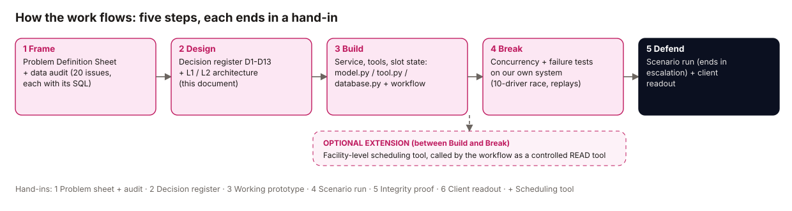
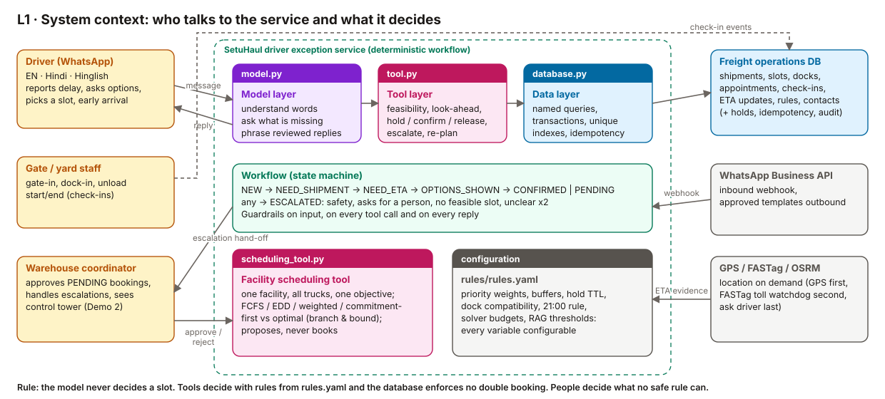
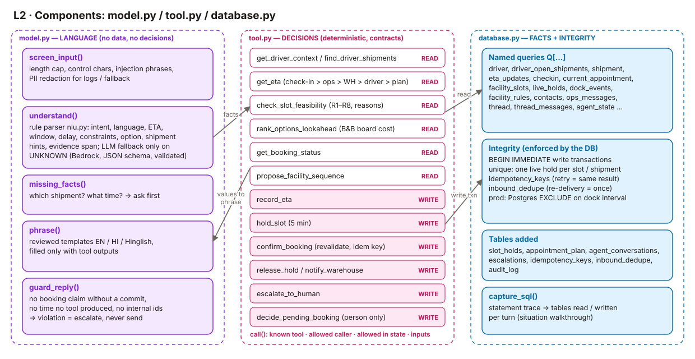
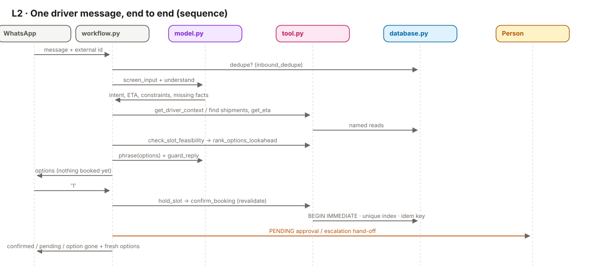
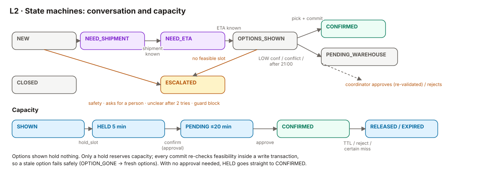

# SetuHaul: L1 and L2 system design

This document has two levels of detail, so each reader can stop where they have what they need.

* **L1 (what the system does, and who decides what)** is for the head of operations, the warehouse planner and anyone deciding whether to trust it.
* **L2 (how it works)** is for engineers: the components, contracts, data access, concurrency and tests. It names the three code layers: [`setuhaul/model.py`](https://github.com/sdaistudio/SetuHaul_Logistics/blob/main/setuhaul/model.py), [`setuhaul/tool.py`](https://github.com/sdaistudio/SetuHaul_Logistics/blob/main/setuhaul/tool.py) and [`setuhaul/database.py`](https://github.com/sdaistudio/SetuHaul_Logistics/blob/main/setuhaul/database.py), plus the facility scheduling tool [`setuhaul/scheduling_tool.py`](https://github.com/sdaistudio/SetuHaul_Logistics/blob/main/setuhaul/scheduling_tool.py).

Every table marked *generated* below is produced from the code and from a recorded run (`tools/build_design_doc.py`), not typed by hand.

## How the brief maps to this design

| Brief: Learn (FDE judgement) | Where it is handled |
|---|---|
| Frame an unclear operations problem from a messy data package | Problem definition sheet + 20 data issues, each proved by SQL ([problem.html](problem.html), [audit.html](audit.html)) |
| Decide which choices belong to a model, a tool, a database or a person | L1 §3 decision split; L2 §6 to §8 layer contracts |
| Reason about stale reads, concurrent requests and promises | L2 §10: holds, revalidation at commit, unique indexes, idempotency, dedupe |
| Weigh priority, waiting time, fairness and appointment commitments | L2 §11 allocation policy; L2 §12 facility objective |
| Design safe failure and escalation | L1 §5; L2 §13 escalation routes and hand-off record |

| Brief: Apply (tools you already have) | Where it is handled |
|---|---|
| Tool calling with structured inputs and outputs | `tool.py` contracts (L2 §7), validated by `tool.call()` |
| Conversation state and memory across turns | `agent_conversations` row with a version number (L2 §9, state machine) |
| The choice between a fixed workflow and an agent | Fixed workflow (L1 §2); the model never chooses the next step |
| Human approval checkpoints | PENDING bookings, swaps and moved promises go to a coordinator (L2 §13) |
| SQL, constraints and transactions | `database.py`: named queries, BEGIN IMMEDIATE, partial unique indexes (L2 §8, §10) |
| Multi-turn evaluation of agent behaviour | Scenario run + eval gates (L2 §15) |

| Brief: Build (what you ship) | Where it is |
|---|---|
| A conversational exception service for drivers | `workflow.py` on top of the three layers; [Prototype](prototype.html) |
| A capacity layer that holds, confirms and releases slots | `hold_slot` / `confirm_booking` / `release_hold` (L2 §10) |
| An escalation path to a human coordinator | `escalate_to_human` + [Demo 2](demo2.html#conversations) queue |
| A test that tries to double-book capacity and fails | `tests/test_integrity.py` (10-driver race, replays) + level 5 below |
| Optional: a facility-level scheduling tool | `scheduling_tool.py` (L2 §12) |

## The workflow we followed

| Step | Hand-in | Proves | Link |
|---|---|---|---|
| 1 Frame | Problem Definition Sheet and data audit | Facts vs estimates vs assumptions vs unknowns; every data issue with the query that proves it | [Problem](problem.html) · [Audit](audit.html) |
| 2 Design | Decision register + this L1/L2 design | Answer, reason and evidence for each decision D1 to D13 | [Decisions](decisions.html) · this page |
| 3 Build | Working prototype | Conversation layer, the tools it calls and the state it keeps (versions in README) | [Prototype](prototype.html) · [code](https://github.com/sdaistudio/SetuHaul_Logistics) |
| + Optional | Facility scheduling tool | Explicit objective vs simple dispatch rules on the competing-trucks snapshot | L2 §12 |
| 4 Break | Integrity proof | Competing requests for the same slot, no double booking | `tests/test_integrity.py`, L2 §10 |
| 5 Defend | Scenario run + client readout | Demonstration list ending in an escalation; policy, limits and open risks | [Scenario run](scenarios.html) · [Readout](readout.html) |

The scenario run covers all seven points the brief lists: (1) a delay plus clarification answers (DRV004, DRV010); (2) later options asked for and compared (DRV001); (3) several requests on one facility schedule; (4) competition for the same capacity (DRV006 and DRV012 on D4 12:30); (5) an option that disappears (OPTION_GONE, then fresh options); (6) an escalation because no safe automatic outcome exists (SHP1015 reefer); (7) the scheduling tool re-planning before and after an ETA update or gate check-in.

---

# L1: what the system does

## 1. Problem and scope

On 4 August at the Jaipur DC, many inbound drivers report delays at once on WhatsApp, in English, Hindi or Hinglish. Each wants a dock slot. Docks have hard limits: dock type, the reefer dock D5, weight limits, maintenance and the 21:00 last-start rule. Some trucks are already in the yard or unloading. The service must answer each driver quickly, offer only slots the truck can really make, never promise the same capacity twice, and hand anything unsafe to a person.

**In scope:** inbound driver exceptions (delay, early arrival, options, status) and slot rebooking at one facility; coordinator approvals and escalations; a facility re-plan proposal.
**Out of scope:** route planning, outbound dispatch, payments and penalties (escalated as `PENALTY_OR_DISPUTE`).

## 2. A fixed workflow, not an autonomous agent

The next step is always chosen by code (a state machine), never by a language model. The only uncertain step is reading the driver's words, and that is done by a deterministic parser with a narrow, validated LLM fallback. Reasons: a wrong slot costs a missed unload or a double booking; behaviour must be explainable to a planner; and the same input must give the same answer so it can be tested.

## 3. Who decides what

| Decision | Belongs to | Why |
|---|---|---|
| What did the driver mean (ETA, delay, constraint, choice, language)? | **Model** (`model.py`) | Only language is fuzzy; output is structured, with evidence spans |
| Is something missing (which shipment, what time)? | **Model** proposes, **workflow** asks | Ask before calling a tool (ladder level 2) |
| Can this truck use this slot? | **Tool** `check_slot_feasibility` | Hard rules R1 to R8 from data and `rules.yaml`; every rejection has a reason code |
| Which slot is best for the driver and the facility? | **Tool** `rank_options_lookahead` | Branch-and-bound look-ahead across all trucks; priority weights CRITICAL 100, HIGH 40, NORMAL 15, LOW 5 |
| Is the slot still free right now? | **Database** | Unique indexes and a write transaction, not the model's memory |
| Book it | **Tool** `hold_slot` → `confirm_booking` | Re-checks feasibility at commit; idempotent |
| A low-confidence ETA, conflicting data, a start after 21:00, moving someone's reachable booking, no feasible slot, safety | **Person** | Policy and accountability decisions; the system prepares the facts and a recommendation |

## 4. Containers on AWS

The production layout is in the [architecture diagram](architecture.svg) and [solution design](design.html). In short: API Gateway receives the WhatsApp webhook; a FIFO SQS queue keyed per driver keeps one driver's messages in order; a worker Lambda runs the workflow; Aurora PostgreSQL stores state (an EXCLUDE constraint on dock intervals); EventBridge runs the sweeper (expires holds and pending bookings); a coordinator API sits behind Cognito; SNS sends notifications; CloudWatch holds metrics, traces and alarms. Bedrock (with a Guardrail) is used only for the language fallback.

## 5. Safe failure and escalation (L1)

* If unsure what the driver meant, ask (at most 2 clarification questions), then hand over to a person.
* If no feasible slot exists, say so, escalate with the facts and the options tried, and tell the driver not to go to the dock until a person confirms.
* If a chosen slot was taken meanwhile, say so and offer fresh options. Never confirm a stale option.
* If a reply would claim a booking that was not committed, or contain a time no tool produced, block it and escalate.
* Safety messages (accident, injury) go straight to the shift manager.
* If a notification fails (OM004 e-mail FAILED in the seed data), the escalation stays OPEN in the queue and is visible on the coordinator dashboard; it is not lost.

## 6. Non-functional targets

| Concern | Target / mechanism |
|---|---|
| Latency | median time to a usable answer 2 min in the scenario run; solver look-ahead budget 400 ms per candidate |
| Consistency | one live hold per slot and per shipment; revalidation at commit; zero double bookings in the race test |
| Determinism | same message + same database → same reply; ties broken by start time, then dock code, then slot id |
| Configurability | every threshold in `rules/rules.yaml` (hold TTL 5 min, gate-to-dock 15 min, ETA buffers, weights, solver budgets) |
| Observability | trace spans per turn, tool-call record, metrics (OptionsShown, OptionGone, Escalations, GuardrailBlocks) |
| Privacy | PII redacted before any LLM call and in logs; drivers only see their own shipments |

---

# L2: how it works

## 7. Components

* **`model.py` (language).** It **may**: detect language, extract intent, extract ETA / delay / window + confidence, extract driver constraints, extract option choice, extract shipment hints, list missing facts, fill a reviewed template. It **may not**: pick or rank a slot, call a WRITE tool, read or write the database, promise a booking, change priority on request, produce a time no tool returned, decide an escalation outcome. A unit test checks that `model.py` imports no database, capacity or solver module and runs no SQL.
* **`tool.py` (decisions).** Deterministic functions with structured inputs and outputs. `call()` checks that the tool exists, that the caller may use it (drivers' workflow vs coordinator vs scheduler), that the conversation state allows it, and that required inputs are present. The workflow uses the same traced functions, so each turn records which tools ran.
* **`database.py` (facts and integrity).** Named read queries, write helpers that only run inside `write_txn` (BEGIN IMMEDIATE), and a SQL capture that lists the tables each turn touched.
* **`workflow.py`** is the state machine that calls the model and the tools in a fixed order. **`scheduling_tool.py`** is the facility-level re-plan.

### 7.1 Tool catalogue *(generated from `tool.SPECS`)*

| Tool | Kind | Caller | Purpose | Inputs | Output | Guardrail |
|---|---|---|---|---|---|---|
| `get_driver_context` | READ | workflow | Who is writing, which shipments are live, thread history | driver_id: str, thread_id: str? | driver, open_shipments[], thread, history[] | Driver can only see own shipments |
| `get_eta` | READ | workflow | Best ETA: gate check-in > ops override > warehouse > driver > plan | shipment_id: str | EtaEstimate(point, confidence, source, window, evidence) | LOW confidence adds a buffer; plan is MEDIUM not HIGH |
| `check_slot_feasibility` | READ | workflow | Hard rules R1-R8 on every slot (dock type, reefer, weight, maintenance, occupancy, holds, 21:00 rule, driver constraints) | shipment_id: str, now: datetime, constraints: Constraints?, eta: EtaEstimate? | SlotEval[] with feasible, reasons[], planned_start/end | Read-only; asking never books |
| `rank_options_lookahead` | READ | workflow | Order the driver's feasible slots by the optimal plan for every other truck (branch & bound look-ahead) | shipment_id: str, now: datetime, eta: EtaEstimate, constraints: Constraints, feasible_slot_ids: list[str] | RankedOption[] (facility cost, trucks stranded) | Deterministic tie-break; time budget from rules.yaml |
| `get_booking_status` | READ | workflow | Live booking, check-in, queue position | shipment_id: str | shipment_status, appointment, checkin | - |
| `record_eta` | WRITE | workflow | Store the driver's new ETA as an eta_updates row | shipment_id: str, eta: datetime, confidence: HIGH|MEDIUM|LOW | eta_update_id | Only after the model's parse is validated; never overwrites plan |
| `hold_slot` | WRITE | workflow | Reserve one slot for 5 minutes while the driver decides/commits | shipment_id: str, slot_id: str (must be one of the options shown), now: datetime | hold_id, expires_at | Unique index: one live hold per slot and per shipment |
| `confirm_booking` | WRITE | workflow | Re-check feasibility inside BEGIN IMMEDIATE, then write the appointment (CONFIRMED or PENDING_CONFIRMATION) | hold_id: str, idem_key: str, approval_reasons: list[str] | appointment_id, status, dock, planned_start/end, replaced | Idempotency key; revalidation; LOW-confidence ETA or data conflict -> PENDING, never auto-confirmed |
| `release_hold` | WRITE | workflow | Give a held slot back (driver declined / timeout) | hold_id: str | released | - |
| `notify_warehouse` | WRITE | workflow | Queue an internal/e-mail message about a booking | shipment_id: str, subject: str | operational_message_id | Delivery status tracked (OM004 FAILED) |
| `escalate_to_human` | WRITE | workflow | Hand the case to a named person with facts, options tried and a recommendation | reason: SAFETY|HUMAN_REQUESTED|NO_FEASIBLE_SLOT|CLARIFICATION_LIMIT|DATA_CONFLICT|GUARDRAIL_BLOCK|RATE_LIMIT, facts: dict | escalation_id, routed_to(role, name, channel), sla | Vacant roles skipped; night shift after 18:00 |
| `decide_pending_booking` | WRITE | coordinator | Approve/reject a PENDING booking (re-validated first) | appointment_id: str, approve: bool, approver: str | status | Human only; approval of an infeasible slot is refused |
| `propose_facility_sequence` | READ | scheduler | Facility-level re-plan after an ETA update or gate check-in: compare dispatch rules with the optimal plan on one objective | facility_id: str, now: datetime, trigger: str | Proposal(objective, protected work, policies[], recommended plan, moves vs today) | Proposes only; a coordinator approves before any booking changes |

## 8. Data access *(generated from `database.Q`)*

Every fact comes from a named, parameterised query. The supplied views (`v_latest_eta`, `v_slot_availability`) are only used for cross-checks, because the audit showed they can mislead (for example `v_latest_eta` reports the original plan as HIGH confidence).

| Named query | What it answers | Tables |
|---|---|---|
| `driver` | Driver profile and phone | drivers |
| `driver_open_shipments` | All of a driver's shipments that are still live today (ambiguity check, DRV004) | shipments |
| `shipment` | One shipment: load, priority, dock type, reefer, weight, unload minutes | shipments |
| `vehicle` | Vehicle type and gross weight (weight-limit rule) | vehicle_types, vehicles |
| `thread` | Seed chat thread (status, intent, linked shipment) | chat_threads |
| `thread_messages` | Messages already exchanged on a thread | chat_messages |
| `agent_state` | Our conversation state machine row (state, language, remembered facts, version) | agent_conversations |
| `eta_updates` | Every ETA statement for a shipment (driver, warehouse, ops override) | eta_updates |
| `latest_eta_view` | Supplied view v_latest_eta (used for comparison only; its confidence is not trusted) | v_latest_eta |
| `checkin` | Gate-in, yard queue, dock-in, unload start/end (ground truth once the truck is here) | facility_checkins |
| `current_appointment` | The shipment's live booking and its slot window | appointment_slots, appointments, docks |
| `appointment` | One appointment by id (APT1008 cancelled mid-conversation) | appointments |
| `facility_slots` | All slots at a facility with dock attributes | appointment_slots, docks |
| `slot_availability_view` | Supplied view v_slot_availability (cross-checked, not trusted alone) | v_slot_availability |
| `live_holds` | Holds still alive (5-minute reservations from other conversations) | slot_holds |
| `dock_events` | Maintenance, blockages, capacity reductions on docks | dock_status_events, docks |
| `facility_rules` | Facility rules (reefer dock, heavy dock, last new start 21:00, no-show grace) | facility_rules |
| `facility_queue_view` | Supplied view v_current_facility_queue (who is at the DC now) | v_current_facility_queue |
| `contacts` | Who to escalate to (role, name, channel); vacant posts are skipped | facility_contacts |
| `ops_messages` | Messages already sent about a shipment (OM004: escalation e-mail FAILED) | operational_messages |
| `open_escalations` | Escalations waiting for a person | escalations |

Tables added to the supplied schema: `slot_holds`, `appointment_plan`, `agent_conversations`, `escalations`, `idempotency_keys`, `inbound_dedupe`, `audit_log` (see `setuhaul/db.py`). The supplied snapshot is never modified; each run works on a copy.

## 9. One message, end to end

Conversation memory is one `agent_conversations` row per thread: state, language, remembered facts (shipment, ETA, constraints, options shown, clarification count) and a version number that is checked on save (optimistic concurrency). Facts said in an earlier turn are kept, so "016 wala" after a question resolves the shipment without the driver repeating the ETA.

## 10. Stale reads, concurrent requests and promises

| Risk | Mechanism | Evidence |
|---|---|---|
| Two drivers pick the same slot | Hold placed inside BEGIN IMMEDIATE; partial unique index `ux_live_hold_per_slot`; the second gets OPTION_GONE | 10-driver race in `tests/test_integrity.py`; level 5 race: {'slot': 'SLOT-JAI-006', 'SHP1017': 'HOLD-A7DE59F0', 'SHP1018': 'OPTION_GONE'} |
| Options shown, then the world changes | Options hold nothing; `confirm_booking` re-runs feasibility inside the write transaction | Level 5: DRV012 picks D4 12:30 after a parallel booking took it → "just taken" + fresh options |
| A retried confirm (network retry) | `idempotency_keys`: same key returns the first result | Level 5: first APT-A1A5817A and retry APT-A1A5817A, replay = True |
| WhatsApp re-delivers a message (THR001 / THR009) | `inbound_dedupe` on external id and normalised text within a window | Level 5: second copy suppressed, no tool called |
| Asking is mistaken for booking | Options are READ only; a booking needs an explicit choice | Level 1: appointments created 0, holds created 0 |
| A booking that can no longer be reached blocks a slot | Certain-miss release: if the owner's ETA is past the slot end, the slot is released (and the owner's dispatcher is told) | `capacity.commit_hold`, solver tests |
| Holds or pending bookings left forever | TTL: hold 5 min, pending approval 20 min; the sweeper expires them | `capacity.expire_stale` |
| Production | Postgres `EXCLUDE USING gist (dock_id WITH =, tstzrange(start, end) WITH &&)` | `infra/postgres_schema.sql` |

## 11. Allocation policy: priority, waiting, fairness, commitments

1. **Hard rules first** (R1 to R8): compatible dock type, reefer to D5, weight limit, dock maintenance or blocks, physical occupancy, live holds, the 21:00 rule (needs approval), and the driver's own constraints (not before X, must leave by Y).
2. **Keep promises:** a reachable booking is not moved because someone else asks. Moving one is a coordinator decision (a swap proposal).
3. **Priority comes from data only** (`shipments.priority_code`), never from the message. "Load bahut zaroori hai" gets a polite note, not a higher rank.
4. **Look-ahead, not first-come:** each feasible slot for this driver is scored by solving the rest of the facility as if the driver took it (branch and bound). The driver gets the slots that strand nobody else and keep total priority-weighted waiting lowest.
5. **Fairness:** the same rules, weights and tie-breaks for every driver; LOW-priority trucks are delayed only when the weighted cost says so, and never left without a dock if one exists.

## 12. Facility-level scheduling tool

`scheduling_tool.propose_sequence()` is called (through `tool.propose_facility_sequence`) after an ETA update or a gate check-in, or by a coordinator. It reads structured data only and **never writes**: the run below checked `wrote_to_database = False`.

**Model:** job = truck; machine = dock; release = planning ETA + 15 min gate-to-dock (or now if already in the yard); processing = expected unload minutes; due = current booking; fixed = trucks already unloading (protected work) and dock events.

**Objective, in order:** 1 nobody left without a dock > 2 fewest missed appointments > 3 least priority-weighted wait > 4 fewest schedule changes. Weights per minute of waiting: CRITICAL 100, HIGH 40, NORMAL 15, LOW 5.

**Comparison on the 09:50 snapshot** *(generated)*:

| Policy | Unscheduled | Missed appointments | Weighted wait | Schedule changes | Avg wait (min) |
|---|---|---|---|---|---|
| FCFS | 1 | 1 | 5200 | 8 | 8.3 |
| EDD | 1 | 1 | 3300 | 8 | 12.3 |
| WEIGHTED | 1 | 1 | 4950 | 11 | 32.0 |
| COMMITMENT_FIRST_WEIGHTED | 1 | 0 | 7450 | 6 | 15.7 |
| COMMITMENT_FIRST_WEIGHTED + approved swaps | 1 | 0 | 3775 | 7 | 24.0 |
| OPTIMAL (branch & bound, proven optimal) | 1 | 1 | 4900 | 6 | 17.7 |

Recommended: **COMMITMENT_FIRST_WEIGHTED + approved swaps**. Protected work: D2 08:05-10:00 SHP1002 on dock; D2 08:08-10:00 SHP1002 unloading. Every move of a reachable booking, every swap and every start after 21:00 is listed for a coordinator. Before and after an event:

* ETA update SHP1009 -> 12:20: SHP1003 D2 12:55 → D2 11:00; SHP1014 D2 11:40 → D4 11:40; SHP1013 D4 12:30 → D2 11:45; SHP1009 D4 11:15 → D1 12:35; SHP1012 D1 12:20 → D2 12:45; SHP1018 D3 13:00 → D4 12:55; SHP1017 D1 13:15 → D3 13:15
* gate check-in SHP1014 at 10:45: SHP1014 D2 11:40 → D2 10:55; SHP1005 D4 12:30 → D2 12:10; SHP1012 D2 12:55 → D4 12:30; SHP1003 D2 10:55 → D4 13:15; SHP1017 D2 13:40 → D2 13:25

Run it: `python -m setuhaul.scheduling_tool --at 09:50` or `python -m setuhaul.scheduling_tool --at 09:50 --eta SHP1009=12:20`.

## 13. Human approval checkpoints and escalation

| Checkpoint | Trigger | Who | What they receive |
|---|---|---|---|
| Pending booking | LOW-confidence ETA, data conflict, start after 21:00 | Warehouse coordinator | Booking, reasons, 20-minute TTL; approval is re-validated (an infeasible slot is refused) |
| Moved promise / swap | Scheduler proposes moving a reachable booking | Warehouse coordinator | Before/after, who is displaced, driver notice needed |
| No feasible slot | Feasibility returns nothing | Coordinator (night shift after 18:00) | Facts, ETA, constraints, rejection summary, options tried, recommendation |
| Safety | Accident or injury words | Shift manager | Redacted message; SLA 5 min |
| Unclear after 2 tries / guard block / rate limit | Workflow | Coordinator | Last message, what was asked |

Routing skips vacant roles and contacts without a channel (`facility_contacts`), and falls back to the ops queue.

## 14. How data is fetched in each situation *(generated from a recorded run)*

Each level of the brief's ladder was run through the production workflow on a fresh copy of the database. The model column shows what the language layer extracted; the other columns come from the tool-call record and SQLite's statement trace. Full turn-by-turn detail, including replies, is on the [situation walkthrough](walkthrough.html) page.

| Level | Case (driver) | Model step (language only) | Tools called, in order | Key tool result | Tables read | Tables written | States |
|---|---|---|---|---|---|---|---|
| 1 | A driver only asks about options (DRV001) | en, REPORT_DELAY/ASK_OPTIONS, eta 12:45 CLOCK MEDIUM, not before 13:00 / hinglish, ASK_OPTIONS, not before 15:00 / hinglish, DECLINE | `find_driver_shipments` → `get_eta` → `record_eta` → `check_slot_feasibility` → `rank_options_lookahead` → `find_driver_shipments` → `get_eta` → `check_slot_feasibility` → `rank_options_lookahead` → `find_driver_shipments` | 68 slots checked, 35 feasible; rejected: DOCK_TYPEx20, SLOT_TAKENx7, SLOT_BLOCKEDx7; planning ETA 13:00 · 68 slots checked, 27 feasible; rejected: DOCK_TYPEx20, BEFORE_DRIVER_EARLIESTx13, SLOT_TAKENx7; planning ETA 13:00 | shipments, facility_checkins, appointment_slots, eta_updates, appointments, agent_conversations, driver_exceptions, facilities … | chat_threads, chat_messages, driver_exceptions, inbound_dedupe, eta_updates, agent_conversations | options shown → options shown → need eta |
| 2a | The message misses key facts (DRV013) | en, REPORT_DELAY, eta 10:39 RELATIVE_DELAY MEDIUM, delay 60m | `find_driver_shipments` → `get_eta` → `record_eta` → `check_slot_feasibility` → `rank_options_lookahead` | 73 slots checked, 38 feasible; rejected: DOCK_TYPEx21, SLOT_TAKENx10, SLOT_BLOCKEDx7; planning ETA 11:15 | shipments, facility_checkins, appointment_slots, eta_updates, appointments, agent_conversations, driver_exceptions, facilities … | chat_threads, chat_messages, inbound_dedupe, eta_updates, driver_exceptions, agent_conversations | pending warehouse |
| 2b | 〃 (DRV004) | hi, REPORT_DELAY, eta 10:26 RELATIVE_DELAY MEDIUM, delay 45m / hi, UNKNOWN | `find_driver_shipments` → `get_eta` → `record_eta` → `check_slot_feasibility` → `rank_options_lookahead` | 73 slots checked, 12 feasible; rejected: ETA_AFTER_WINDOWx29, DOCK_TYPEx21, SLOT_TAKENx10; planning ETA 19:00 | chat_threads, facilities, chat_messages, inbound_dedupe, agent_conversations, shipments, facility_checkins, appointment_slots … | chat_threads, chat_messages, inbound_dedupe, agent_conversations, driver_exceptions, eta_updates | need shipment → options shown |
| 2c | 〃 (DRV010) | hinglish, REPORT_DELAY, clarify ['ETA_VAGUE'] / hinglish, ADD_CONSTRAINT, leave by 11:30 | `find_driver_shipments` → `get_eta` → `find_driver_shipments` → `get_eta` → `record_eta` → `check_slot_feasibility` → `rank_options_lookahead` | 73 slots checked, 6 feasible; rejected: DOCK_TYPEx60, SLOT_TAKENx9, SLOT_BLOCKEDx7; planning ETA 11:45 | chat_threads, shipments, chat_messages, inbound_dedupe, agent_conversations, facilities, facility_checkins, eta_updates … | chat_threads, chat_messages, inbound_dedupe, agent_conversations, driver_exceptions, eta_updates | need eta → options shown |
| 3a | Rules and compatibility narrow the choices (DRV007) | en, REPORT_DELAY/ASK_OPTIONS, eta 12:00 CLOCK HIGH / hinglish, IDENTIFY_SHIPMENT | `find_driver_shipments` → `get_eta` → `record_eta` → `check_slot_feasibility` → `rank_options_lookahead` | 73 slots checked, 6 feasible; rejected: WEIGHTx65, DOCK_TYPEx65, SLOT_TAKENx11; planning ETA 12:00 | chat_threads, facilities, chat_messages, inbound_dedupe, agent_conversations, shipments, facility_checkins, appointment_slots … | chat_threads, chat_messages, inbound_dedupe, agent_conversations, driver_exceptions, eta_updates | need shipment → options shown |
| 3b | 〃 (DRV010) | hinglish, REPORT_DELAY, eta 11:30 CLOCK MEDIUM | `find_driver_shipments` → `get_eta` → `record_eta` → `check_slot_feasibility` → `rank_options_lookahead` | 73 slots checked, 6 feasible; rejected: DOCK_TYPEx60, SLOT_TAKENx10, SLOT_BLOCKEDx7; planning ETA 11:45 | shipments, facility_checkins, appointment_slots, eta_updates, appointments, agent_conversations, driver_exceptions, facilities … | chat_threads, chat_messages, driver_exceptions, inbound_dedupe, eta_updates, agent_conversations | options shown |
| 4a | Several delayed trucks chase nearby slots (DRV006) | en, REPORT_DELAY/ASK_OPTIONS, eta 11:20 CLOCK MEDIUM, not before 12:00 | `find_driver_shipments` → `get_eta` → `record_eta` → `check_slot_feasibility` → `rank_options_lookahead` | 73 slots checked, 37 feasible; rejected: DOCK_TYPEx21, SLOT_TAKENx11, SLOT_BLOCKEDx7; planning ETA 11:35 | shipments, facility_checkins, appointment_slots, eta_updates, appointments, agent_conversations, driver_exceptions, facilities … | chat_threads, chat_messages, driver_exceptions, inbound_dedupe, eta_updates, agent_conversations | options shown |
| 4b | 〃 (DRV012) | en, REPORT_DELAY, eta 11:10 CLOCK HIGH, leave by 13:30 | `find_driver_shipments` → `get_eta` → `record_eta` → `check_slot_feasibility` → `rank_options_lookahead` | 73 slots checked, 1 feasible; rejected: DRIVER_DEADLINEx36, DOCK_TYPEx21, SLOT_TAKENx11; planning ETA 11:10 | shipments, facility_checkins, eta_updates, appointment_slots, appointments, agent_conversations, chat_threads, driver_exceptions … | chat_threads, chat_messages, driver_exceptions, inbound_dedupe, eta_updates, agent_conversations | options shown |
| 4c | 〃 (DRV013) | en, REPORT_DELAY, eta 10:39 RELATIVE_DELAY MEDIUM, delay 60m | `find_driver_shipments` → `get_eta` → `record_eta` → `check_slot_feasibility` → `rank_options_lookahead` | 73 slots checked, 38 feasible; rejected: DOCK_TYPEx21, SLOT_TAKENx10, SLOT_BLOCKEDx7; planning ETA 11:15 | shipments, facility_checkins, appointment_slots, eta_updates, appointments, agent_conversations, driver_exceptions, facilities … | chat_threads, chat_messages, inbound_dedupe, eta_updates, driver_exceptions, agent_conversations | pending warehouse |
| 4d | 〃 (DRV014) | hi, SELECT_OPTION/REPORT_DELAY, eta 11:25 CLOCK HIGH, option 1 / en, SELECT_OPTION, option 1 | `find_driver_shipments` → `get_eta` → `record_eta` → `check_slot_feasibility` → `rank_options_lookahead` → `find_driver_shipments` → `get_eta` → `hold_slot` → `confirm_booking` → `notify_warehouse` → `get_eta` | 73 slots checked, 17 feasible; rejected: WEIGHTx26, DOCK_TYPEx21, SLOT_TAKENx10; planning ETA 11:25 · CONFIRMED D2 12:30 (replaces APT1014A) | shipments, facility_checkins, appointment_slots, eta_updates, appointments, agent_conversations, driver_exceptions, facilities … | chat_threads, chat_messages, driver_exceptions, inbound_dedupe, eta_updates, agent_conversations, slot_holds, audit_log, appointments, appointment_plan, idempotency_keys, operational_messages | options shown → confirmed |
| 5a | The world changes mid-conversation (DRV006) | en, REPORT_DELAY/ASK_OPTIONS, eta 11:20 CLOCK MEDIUM, not before 12:00 | `find_driver_shipments` → `get_eta` → `record_eta` → `check_slot_feasibility` → `rank_options_lookahead` | 73 slots checked, 37 feasible; rejected: DOCK_TYPEx21, SLOT_TAKENx11, SLOT_BLOCKEDx7; planning ETA 11:35 | shipments, facility_checkins, appointment_slots, eta_updates, appointments, agent_conversations, driver_exceptions, facilities … | chat_threads, chat_messages, driver_exceptions, inbound_dedupe, eta_updates, agent_conversations | options shown → duplicate suppressed |
| 5b | 〃 (DRV012) | en, REPORT_DELAY, eta 11:10 CLOCK HIGH, leave by 13:30 / en, SELECT_OPTION, option 1 | `find_driver_shipments` → `get_eta` → `record_eta` → `check_slot_feasibility` → `rank_options_lookahead` → `find_driver_shipments` → `get_eta` → `hold_slot ✗` → `get_eta` → `check_slot_feasibility` → `rank_options_lookahead` | 73 slots checked, 1 feasible; rejected: DRIVER_DEADLINEx36, DOCK_TYPEx21, SLOT_TAKENx11; planning ETA 11:10 · CapacityError: OPTION_GONE · 73 slots checked, 2 feasible; rejected: DRIVER_DEADLINEx35, DOCK_TYPEx21, SLOT_TAKENx11; planning ETA 11:10 | shipments, facility_checkins, eta_updates, appointment_slots, appointments, agent_conversations, chat_threads, driver_exceptions … | chat_threads, chat_messages, driver_exceptions, inbound_dedupe, eta_updates, agent_conversations, slot_holds | options shown → options shown |
| 5b′ parallel booking | 〃 (OTHER) | - | `hold_slot` → `confirm_booking` | CONFIRMED D4 12:30 (replaces APT1013A) | shipments, facility_checkins, eta_updates, appointment_slots, appointments, slot_holds, facilities, docks … | slot_holds, audit_log, appointments, appointment_plan, idempotency_keys | parallel booking confirmed |
| 6 | No feasible slot exists (DRV015) | en, REPORT_DELAY, eta 18:30 CLOCK HIGH | `find_driver_shipments` → `get_eta` → `record_eta` → `check_slot_feasibility` → `escalate_to_human` | 34 slots checked, 0 feasible; rejected: DOCK_TYPEx28, SLOT_BLOCKEDx4, ETA_AFTER_WINDOWx2; planning ETA 18:30 · ESC-6CD63409 NO_FEASIBLE_SLOT -> WAREHOUSE_COORDINATOR Neha Bansal via EMAIL | shipments, facility_checkins, eta_updates, chat_threads, appointment_slots, facilities, docks, appointments … | chat_threads, chat_messages, driver_exceptions, inbound_dedupe, eta_updates, escalations, audit_log, agent_conversations | escalated |
| + | An early truck, a late truck and work in progress share one facility | none (structured data only) | `propose_facility_sequence` | recommend COMMITMENT_FIRST_WEIGHTED + approved swaps | shipments, facility_checkins, eta_updates, appointment_slots, appointments, driver_exceptions, agent_conversations, facilities … | none | proposal for a coordinator |

Note on level 2a: "late by one hour" is parsed by the model as now + 60 min; the workflow then anchors a relative delay to the shipment's planned ETA (10:00 + 60 = 11:00) and states that assumption in the reply, so the driver can correct it.

**Data used to frame each case:**

| Level | Where to look | Named queries that frame the case |
|---|---|---|
| 1 | `THR011, SHP1017` | `thread(THR011)` → 1 row(s), `thread_messages(THR011)` → 1 row(s), `shipment(SHP1017)` → 1 row(s), `current_appointment(SHP1017)` → 1 row(s) |
| 2 | `THR003, SHP1013, THR010, DRV004` | `thread_messages(THR003)` → 2 row(s), `thread_messages(THR010)` → 2 row(s), `driver_open_shipments(DRV004)` → 2 row(s), `eta_updates(SHP1013)` → 1 row(s) |
| 3 | `SHP1010, SHP1015, SHP1016, RULE005` | `facility_rules(FAC-JAI-01)` → 5 row(s), `shipment(SHP1016)` → 1 row(s), `shipment(SHP1010)` → 1 row(s), `dock_events(FAC-JAI-01)` → 3 row(s) |
| 4 | `SHP1006, SHP1012, SHP1013, SHP1014, SHP1009` | `eta_updates(SHP1006)` → 2 row(s), `eta_updates(SHP1012)` → 1 row(s), `eta_updates(SHP1014)` → 1 row(s), `current_appointment(SHP1009)` → 1 row(s) |
| 5 | `SHP1005, APT1008, THR001, THR009, SHP1002` | `thread_messages(THR009)` → 1 row(s), `appointment(APT1008)` → 1 row(s), `checkin(SHP1005)` → 1 row(s), `checkin(SHP1002)` → 1 row(s) |
| 6 | `SHP1015, THR005, OM004` | `thread_messages(THR005)` → 2 row(s), `ops_messages(SHP1015)` → 1 row(s), `contacts(FAC-JAI-01)` → 3 row(s), `dock_events(FAC-JAI-01)` → 3 row(s) |

## 15. Evaluation and break tests

* **Unit and integrity tests** (`tests/`): 10-driver race on one slot, replayed confirms, duplicate deliveries, certain-miss release, solver optimality, and the layer contracts in `tests/test_layers.py` (model has no data access, asking writes nothing, write tools blocked in the wrong state, scheduler writes nothing).
* **Eval gates** (`evals/run_evals.py`, run in CI): NLU on tuned and held-out sets (EN, HI, Hinglish), feasibility golden cases, guardrail cases, solver vs OR-Tools CP-SAT. See [evals](evals.html).
* **Multi-turn scenario run** (`scenarios/run_scenarios.py`): 12 conversations replayed against one facility, ending in an escalation, with metrics (resolved without takeover, time to usable answer, double bookings = 0). See [scenario run](scenarios.html).

## 16. Library versions

Python 3.10+ (tested on 3.13), PyYAML 6.0, OR-Tools 9.15 (optional, for the CP-SAT cross-check), Markdown 3.x (site build only). No other runtime dependencies: SQLite is from the Python standard library.
